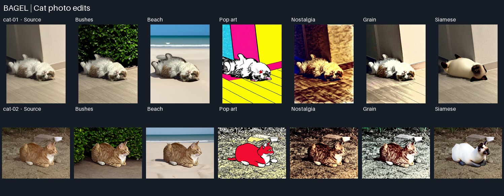
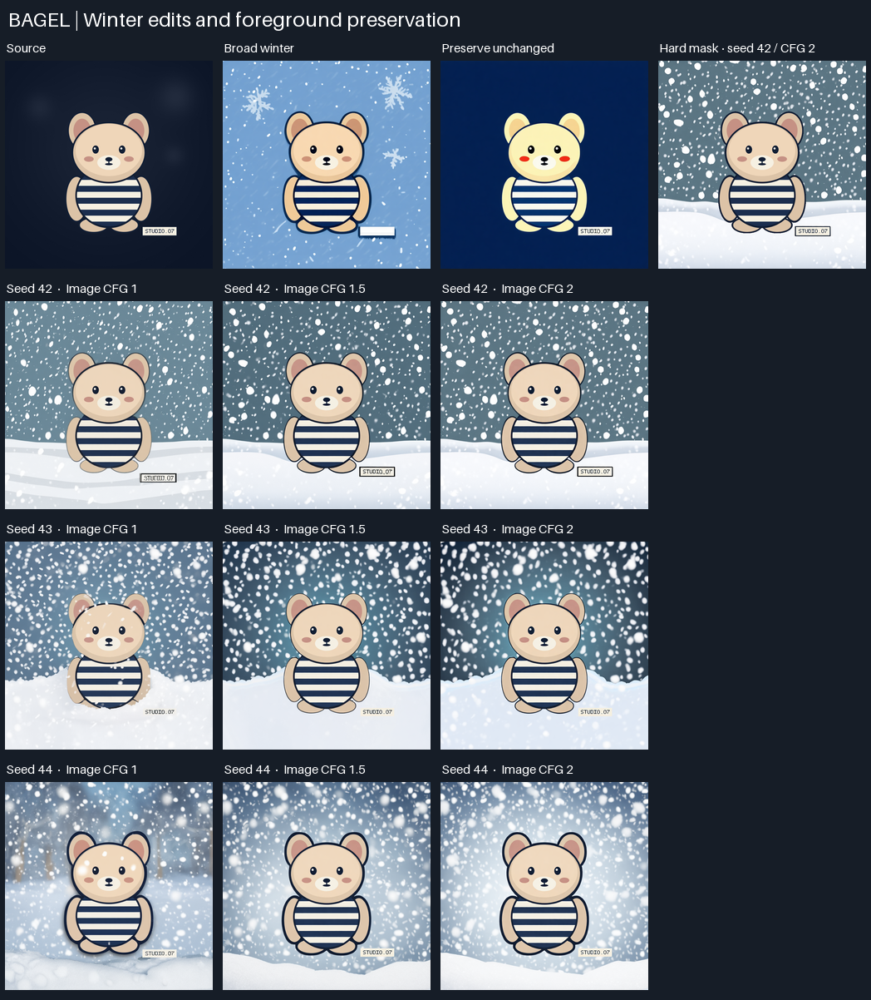

# BAGEL 추론 CLI

[English README](README.md)

ByteDance Seed의 BAGEL-7B-MoT를 터미널에서 실행하는 프로젝트입니다. 공식 노트북의 모델 로딩과 작업별 설정을 하나의 CLI로 옮겨 텍스트로 이미지 생성, 지시에 따른 이미지 편집, 이미지 질의응답을 실행합니다. 결과는 PNG 또는 UTF-8 텍스트로 저장합니다.

## 고양이 사진 추론 실험



자세와 배경이 다른 사진 두 장을 사용합니다. `cat-01`은 실내 나무 바닥에 배를 보이고 누운 흰색·갈색 장모 고양이(768 × 1024)입니다. `cat-02`는 흙바닥에 웅크리고 오른쪽을 보는 흰 가슴의 주황색 줄무늬 고양이(1024 × 768)입니다. `results/cat-study/inputs/`의 실행용 사진은 해상도를 유지하고 EXIF를 제거했습니다.

[배치 실행 코드](scripts/run_cat_study.py)는 BAGEL을 한 번 불러오고 매 작업을 각 사진의 원본에서 시작합니다. 두 사진에는 같은 일곱 프롬프트를 적용합니다. 편집 설정은 시드 `42`, 스텝 설정 `50`, 텍스트 가이던스 `4.0`, 이미지 가이던스 `2.0`입니다. 설명은 그리디 디코딩과 256토큰 한도를 사용합니다. 정확한 프롬프트, 입력 해시, 실행 인자는 `results/cat-study/plan.json`에 저장합니다.

| 작업 | 고양이별 출력 파일 | 원본과 비교할 항목 |
| --- | --- | --- |
| 사진 설명 | `01-understand.txt` | 털색, 자세나 시선, 주변 환경을 묘사하는지와 추측성 정보 |
| 수풀 배경 | `02-bushes.png` | 수풀, 털 경계, 바닥과 닿는 모습 |
| 해변 배경 | `03-beach.png` | 모래와 멀리 보이는 바다, 원래 자세와 구도 |
| 팝아트 | `04-pop-art.png` | 진한 윤곽선, 색면, 망점과 원래 구도 |
| 노스탤지어 필터 | `05-nostalgia.png` | 따뜻한 밝은 부분, 낮아진 채도, 옅어진 검은색과 원래 장면의 디테일 |
| 그레인 증가 | `06-grain.png` | 매끈한 부분에 보이는 미세 입자와 기존 밝기·색 유지 |
| 고양이 품종 외형 변경 | `07-breed.png` | 짧은 털, 크림색 몸통, 짙은 샴 포인트와 원래 자세·배경 |

GPU 서버의 저장소 루트에서 입력 사진 두 장의 경로를 지정해 실행합니다.

```bash
python -m scripts.run_cat_study \
  path/to/first-cat.png \
  path/to/second-cat.png
```

결과는 `results/cat-study/cat-01/`과 `results/cat-study/cat-02/`에 저장됩니다. 같은 계획으로 다시 실행하면 아직 없는 출력부터 이어서 만듭니다. `--plan-only`를 붙이면 모델을 불러오지 않고 입력과 설정을 기록합니다.

14개 결과는 Vast.ai의 NVIDIA L40S에서 생성했습니다. 두 실험 모두 체크포인트 리비전 `5019f57d168e5816e8f3f701b17cc816bb7cf24b`, PyTorch 2.5.1과 CUDA 12.4, FlashAttention 2.7.4.post1을 사용했습니다. 고양이 배치에는 최초 모델 로딩을 포함해 24분 20초가 걸렸습니다. 실행 환경은 로컬 `results/cat-study/runtime.json`에 기록했습니다.

| 작업 | 고양이 01, 실내 장모 고양이 | 고양이 02, 실외 주황색 줄무늬 고양이 |
| --- | --- | --- |
| 설명 | 흰색·갈색 털, 등을 대고 누운 자세, 실내 바닥과 벽을 정확히 짚었습니다. | 주황색 털, 흰 가슴, 오른쪽 시선, 흙과 그릇을 정확히 묘사했습니다. “흰 발들”이라는 표현은 사진에서 확인되는 범위를 넘어섭니다. |
| 수풀 | 벽을 녹색 잎으로 바꿨고, 나무 바닥과 누운 자세를 유지했습니다. | 그릇과 돌을 없애고 수풀을 추가했으며 흙바닥을 매끈하게 바꿨습니다. 자세와 털 무늬는 알아볼 수 있습니다. |
| 해변 | 나무 바닥을 모래로 바꾸고 수평선과 파도를 넣었습니다. 자세는 남았고, 털 윤곽은 단순해지고 그림자는 짙어졌습니다. | 모래와 파도를 넣으면서 오른쪽 시선을 유지했습니다. 털 경계가 날카롭고 그림자 끝이 각져 합성한 듯 보입니다. |
| 팝아트 | 벽과 바닥을 시안·마젠타·노랑 색면으로 바꿨습니다. 벽에 작은 망점이 보이고, 검은 선은 방의 원근과 고양이 위치를 살렸습니다. | 고양이가 붉은 색면과 굵은 윤곽선으로 바뀌고 그릇은 남았습니다. 망점은 덜 뚜렷하고, 원본에서 보이지 않던 꼬리가 생겼으며 발 모양도 달라졌습니다. |
| 노스탤지어 | 따뜻한 색과 깊은 그림자가 생겼고, 벽과 바닥의 질감도 새로 그렸습니다. | 따뜻한 색과 깊은 그림자가 생겼고, 털과 흙의 질감이 과장됐습니다. |
| 그레인 | 벽과 털이 밝아지고 전체 대비가 커졌습니다. 비교한 벽 영역의 미세 밝기 변화는 줄었습니다. | 바닥이 밝고 차가운 색으로 바뀌고, 털과 흙의 대비가 강해졌습니다. |
| 샴 외형 | 몸통이 크림색, 얼굴과 귀가 짙은 색으로 바뀌었습니다. 누운 방향은 남았고 몸통과 발 모양이 달라졌습니다. | 크림색 몸통과 짙은 포인트가 생겼고, 시선과 돌·그릇은 유지됐습니다. 몸의 윤곽과 발은 달라졌습니다. |

해변 지시에서 고양이 아래의 모래를 명시하자 바닥도 함께 바뀌었습니다. 수풀 지시에서는 어디부터를 배경으로 볼지 모델이 정할 여지가 더 컸습니다. 노스탤지어 편집 뒤 8비트 밝기가 10 이하인 픽셀 비율은 고양이 01에서 **0.01%에서 12.12%**, 고양이 02에서 **0.02%에서 18.63%**로 늘었습니다. 그림자가 더 깊어 보이는 것과 일치합니다. 밝기는 저장된 RGB값에 `0.2126R + 0.7152G + 0.0722B`를 적용했습니다.

고양이 01의 벽 영역 `(552, 60)–(716, 210)`을 잘라 8비트 밝기 영상에서 1.2픽셀 가우시안 블러를 뺀 잔차를 계산했습니다. 그레인 편집 전후 잔차의 RMS는 **4.58에서 1.77**로 줄었습니다. 영역 가장자리 4픽셀은 계산에서 뺐습니다. 이 수치는 벽 한 곳의 미세 밝기 변화를 보여줍니다. 밝기와 색을 고정한 채 정해진 세기의 밝기 노이즈를 추가하는 필터를 대조군으로 삼으면 그레인 효과만 비교할 수 있습니다.

## 겨울 편집과 원본 전경 보존



어두운 배경에 줄무늬 장난감과 `STUDIO.07` 라벨이 있는 768 × 768 합성 이미지를 사용합니다. [입력 생성 코드](scripts/make_edit_fixture.py)는 장난감과 라벨의 이진 마스크도 만듭니다. 보존할 픽셀의 위치와 라벨의 정확한 문자열을 알고 비교할 수 있습니다.

- **프롬프트 범위.** 시드 `42`, 50스텝, 텍스트 가이던스 `4.0`, 이미지 가이던스 `2.0`에서 세 지시를 비교합니다. 포괄적인 겨울 분위기, 자세·줄무늬·라벨을 유지하면서 배경에만 눈을 내리게 하는 지시, 전체 이미지를 그대로 유지하라는 지시입니다.
- **이미지 가이던스.** 배경 편집 프롬프트와 텍스트 가이던스를 고정하고 이미지 가이던스 `1.0`, `1.5`, `2.0`을 시드 `42`, `43`, `44`에서 각각 실행합니다. `1.0`에서 추가 이미지 가이던스가 꺼져도 원본은 입력 문맥에 남습니다. 시드 42·가이던스 2 결과는 두 비교에 공통으로 사용합니다.
- **전경 보존.** [측정 코드](scripts/measure_winter_study.py)는 전경 내부, 배경 내부, 마스크 경계 안팎 5픽셀 띠에서 원본 대비 8비트 RGB 평균 절대 차이를 계산합니다. 마스크 안은 원본, 바깥은 시드 42·가이던스 2 편집본으로 합성하고 각 영역이 해당 입력과 픽셀 단위로 일치하는지 확인합니다. 눈이 내리는 모습, 라벨 가독성, 경계의 번짐이나 이중 윤곽은 이미지로 살핍니다.

```bash
python scripts/make_edit_fixture.py
python -m scripts.run_winter_study results/winter-study/inputs/fixture.png
python scripts/measure_winter_study.py
```

L40S에서 이미 불러온 모델을 재사용해 편집 11건을 16분 25초에 마쳤습니다. 원시 편집본, 입력, 마스크, 프롬프트, `metrics.csv`, `hard-mask-composite.png`는 로컬 `results/winter-study/`에 저장했습니다.

| 지시 또는 방식 | 시드 | 이미지 가이던스 | 전경 MAE | 배경 MAE | 경계 MAE |
| --- | ---: | ---: | ---: | ---: | ---: |
| 포괄적 겨울 분위기 | 42 | 2.0 | 11.240 | 136.404 | 51.027 |
| 그대로 유지 | 42 | 2.0 | 21.457 | 18.957 | 19.053 |
| 배경만 편집 | 42 | 1.0 | 5.368 | 143.648 | 114.660 |
| 배경만 편집 | 42 | 1.5 | 3.506 | 131.503 | 87.682 |
| 배경만 편집 | 42 | 2.0 | 3.351 | 138.757 | 89.059 |
| 배경만 편집 | 43 | 1.0 | 9.080 | 151.190 | 142.137 |
| 배경만 편집 | 43 | 1.5 | 3.058 | 134.610 | 120.229 |
| 배경만 편집 | 43 | 2.0 | 3.078 | 133.037 | 114.787 |
| 배경만 편집 | 44 | 1.0 | 23.187 | 156.197 | 56.076 |
| 배경만 편집 | 44 | 1.5 | 3.598 | 159.323 | 56.739 |
| 배경만 편집 | 44 | 2.0 | 3.964 | 176.736 | 64.584 |
| 이진 마스크 합성 | 42 | 2.0 | **0.000** | 138.757 | 67.326 |

**프롬프트 범위.** 시드 42·가이던스 2.0에서 포괄적인 겨울 지시는 장식처럼 큰 눈송이를 넣고 라벨을 빈 칸으로 바꿨습니다. 배경에 한정한 지시는 눈발과 눈밭을 만들고 `STUDIO.07`을 읽을 수 있게 남겼습니다. 전경 MAE는 **11.240에서 3.351**로 줄었습니다. 배경에 한정한 지시에는 정확한 라벨 문구도 들어 있으므로, 이 차이는 두 프롬프트 전체를 비교한 결과입니다. 그대로 유지하라는 지시에서도 형태와 라벨은 남았지만 장난감이 더 노랗고 볼이 더 붉어졌으며, 어두운 배경의 질감이 평평해졌습니다.

**가이던스.** 세 시드의 전경 MAE 평균은 **1.0에서 12.545**, **1.5에서 3.387**, **2.0에서 3.464**였습니다. 1.5와 2.0 모두 세 시드에서 1.0보다 전경 변화가 작았습니다. 1.5와 2.0 중 어느 쪽이 더 가까운지는 시드에 따라 달랐습니다. 1.0에서는 시드 43과 44에서 눈이 얼굴이나 몸 앞으로 넘어왔고, 더 높은 가이던스에서는 줄무늬와 눈의 경계가 더 뚜렷했습니다. 합성 이미지 한 장과 시드 세 개의 관찰입니다.

**마스크 합성.** 라벨을 포함해 마스크 안 **124,845픽셀**이 원본과 정확히 일치했고, 마스크 바깥은 선택한 편집본과 일치했습니다. 모델이 그린 윤곽 일부가 원래 실루엣 바깥에 남아 팔과 발의 선이 두꺼워 보입니다. 배경만 담은 이미지를 쓰거나 보호 영역 바깥에서 정렬한 뒤 경계를 부드럽게 섞는 방식으로 이음새를 줄여볼 수 있습니다. 경계 MAE에는 실루엣 주변의 의도한 배경 변화도 포함되므로 이음새는 이미지로 판정했습니다.

## 실행 방법

BF16을 지원하는 NVIDIA CUDA GPU와 Linux, Python 3.10 환경이 필요합니다. 의존성 설치와 모델 다운로드는 [GPU 실행 가이드](START_HERE.ko.md)를 참고하세요. 설치를 마치면 저장소 루트에서 새 예제 명령을 실행합니다. 편집과 질의응답에는 저장소에 포함된 테스트 이미지를 사용합니다.

```bash
python inference.py --task t2i \
  --prompt "A bagel on a wooden table" \
  --output results/generated.png

python inference.py --task edit --image test_images/octupusy.jpg \
  --prompt "Change the background to a deep blue ocean." \
  --output results/edited.png

python inference.py --task understand --image test_images/octupusy.jpg \
  --prompt "What is shown in this image?" \
  --output results/description.txt
```

`python inference.py --help`로 모델 경로, 시드, 생성 스텝과 가이던스 설정을 확인할 수 있습니다. GPU별 기본 모델 배치 한도는 `40GiB`이며, 실제 추론에는 추가 메모리가 필요합니다. `bash bash-code-example.txt`로 세 예제를 실행할 수 있고, 명령마다 모델을 다시 불러옵니다.

## 이후 실험 아이디어

### 관찰에 근거한 묘사와 글자 판독

- **관찰 누락과 추측.** “이미지를 설명해 줘”와 “자세, 옷이나 표면의 무늬, 배경을 눈에 보이는 내용만 한 줄씩 설명해 줘”를 비교합니다. 입력과 토큰 한도는 고정하고, 필요한 정보를 몇 개 짚었는지와 이미지로 뒷받침할 수 없는 주장이 몇 개인지 따로 셉니다. `--max-tokens`를 낮추면 길이를 제한할 수 있고, 너무 낮으면 답변이 잘릴 수 있습니다.
- **글자 판독.** 전체 이미지와 라벨 영역만 자른 이미지에 같은 질문을 사용합니다. 문장부호까지 그대로 적고 모호하면 `[unclear]`로 표시하라고 요청합니다. 정답과 정확히 일치하는지 확인하고, 빠지거나 추가되거나 바뀐 글자 수를 비교합니다. 잘라낸 이미지에서 판독이 개선된다면 전체 화면에서는 글자 단서가 충분하지 않았다는 가설을 뒷받침합니다.

### 새 이미지 생성 샘플

“파란 접시 위에 플레인 베이글 두 개가 있고 오른쪽에 빨간 컵이 있다”처럼 확인 가능한 조건이 있는 프롬프트를 사용합니다. 시드를 바꿔 여러 장을 생성하고 개수, 접시 색, 컵 위치를 각각 확인합니다. 결과와 함께 정확한 명령, 입력 이미지가 있을 경우 그 해시, 코드 커밋, 모델 리비전, GPU와 CUDA·PyTorch 버전, 실행 시간을 저장합니다.

## 구현 범위

[`inference.py`](inference.py)는 입력을 검사하고, Accelerate로 BF16 체크포인트를 불러와 결과 파일을 씁니다. 공식 [`InterleaveInferencer`](inferencer.py)는 이미지와 텍스트 문맥을 구성합니다. 이미지 편집에는 시각 특징과 VAE 잠재 표현을 사용하고, 이미지 이해는 시각 특징을 바탕으로 텍스트를 생성합니다.

로컬에서 Python 문법, 노트북 파싱, CLI 도움말과 필수 이미지 인자·가중치 누락 처리를 확인했습니다.

기준은 ByteDance Seed의 BAGEL 커밋 `a2fa77d`입니다. 이 프로젝트에서 추가한 부분은 CLI, 실행 문서와 결과 분석입니다. 모델, 노트북, Gradio 앱과 학습·평가 코드는 [Apache 2.0](LICENSE)으로 배포된 공식 저장소에서 가져왔습니다. [공식 README](https://github.com/ByteDance-Seed/BAGEL/blob/a2fa77dd8caeefc41e6607ae0ec17408d3f4ee9f/README.md) · [논문](https://arxiv.org/abs/2505.14683) · [모델 카드](https://huggingface.co/ByteDance-Seed/BAGEL-7B-MoT)
