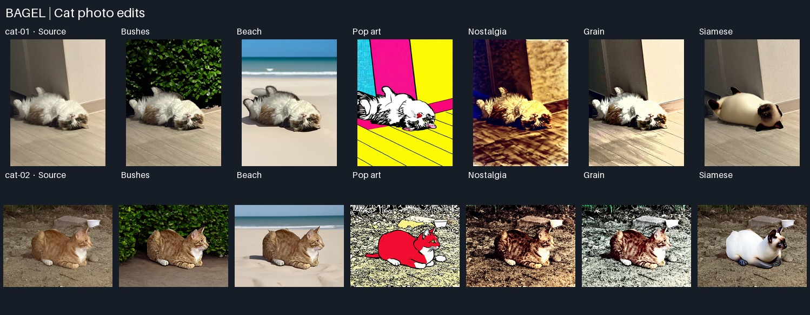
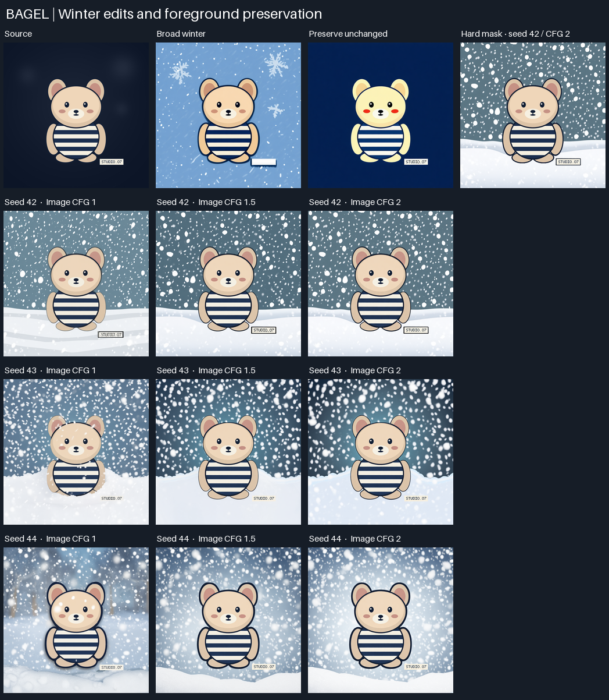

# BAGEL Inference CLI

[한국어 README](README.ko.md)

A command-line interface for ByteDance Seed's BAGEL-7B-MoT. This project ports the model loading and task settings from the upstream notebook into one entry point for text-to-image generation, instruction-based image editing, and visual question answering. Each command saves a PNG or a UTF-8 text response.

## Two-cat inference study



The study uses two source photos with different poses and backgrounds. `cat-01` is a fluffy white-and-brown cat lying on its back on an indoor wood floor (768 × 1024). `cat-02` is an orange tabby with a white chest, crouching on dirt and looking right (1024 × 768). The inputs in `results/cat-study/inputs/` retain their dimensions and have EXIF removed.

The [batch runner](scripts/run_cat_study.py) loads BAGEL once and starts each job from its original photo. Both photos use the same seven prompts. The edits use seed `42`, the `50` step setting, text guidance `4.0`, and image guidance `2.0`. The text response uses greedy decoding and a 256-token limit. `results/cat-study/plan.json` stores the prompts, input hashes, and flags.

| Task | File for each cat | What to compare with the input |
| --- | --- | --- |
| Understand the scene | `01-understand.txt` | Coat, pose or gaze, and setting, with any guesses flagged |
| Replace the background with bushes | `02-bushes.png` | Visible foliage, clean fur edges, and believable contact with the ground |
| Replace the background with a beach | `03-beach.png` | Sand and distant ocean, with the original pose and framing |
| Apply pop art | `04-pop-art.png` | Ink outlines, color blocks, and halftone dots, with the composition retained |
| Apply a nostalgic look | `05-nostalgia.png` | Warm highlights, muted saturation, and faded blacks, with scene details retained |
| Increase film grain | `06-grain.png` | Fine texture visible in smooth areas, with similar brightness and color |
| Change the cat's breed appearance | `07-breed.png` | Short fur, a cream body, and dark Siamese points, with pose and background retained |

On the GPU host, run from the repository root with paths to your two input photos.

```bash
python -m scripts.run_cat_study \
  path/to/first-cat.png \
  path/to/second-cat.png
```

Outputs go into `results/cat-study/cat-01/` and `results/cat-study/cat-02/`. Rerunning the same plan resumes missing outputs. Add `--plan-only` to record the inputs and settings without loading the model.

All 14 outputs were generated on an NVIDIA L40S on Vast.ai. Both studies use checkpoint revision `5019f57d168e5816e8f3f701b17cc816bb7cf24b`, PyTorch 2.5.1 with CUDA 12.4, and FlashAttention 2.7.4.post1. The cat batch took 24 minutes 20 seconds including its initial model load. The local run record is at `results/cat-study/runtime.json`.

| Task | Cat 01, indoor longhair | Cat 02, outdoor tabby |
| --- | --- | --- |
| Understand | Correctly describes the white-and-brown coat, back-down pose, and indoor floor and wall. | Correctly describes the ginger coat, white chest, rightward gaze, dirt, and bowl. The plural “white paws” overstates what is visible. |
| Bushes | Replaces the wall with dense green leaves while keeping the wooden floor and back-down pose. | Removes the original bowl and rocks, adds a hedge, and smooths the dirt. The cat's pose and coat pattern remain recognizable. |
| Beach | Replaces the wood floor with pale sand and adds a horizon and surf. The pose remains, with simplified fur edges and a stronger shadow. | Adds sand and surf while preserving the rightward gaze. A sharp fur edge and a squared-off cast shadow make the result look composited. |
| Pop art | Turns the wall and floor into cyan, magenta, and yellow panels. Fine halftone dots are visible on the wall; ink lines preserve the room's perspective and the cat's position. | Converts the cat into a red color block with heavy outlines and keeps the bowl. Halftone dots are less apparent, and a newly visible tail and altered paws change the anatomy. |
| Nostalgia | Adds a strong warm cast, deep shadows, and new wall and floor texture. | Adds a warm cast, deepens the shadows, and exaggerates fur and ground texture. |
| Grain | Makes the wall and fur brighter and increases overall contrast. Fine variation in the sampled wall patch decreases. | Shifts the ground toward a cooler, brighter palette and emphasizes contrast in the coat and dirt. |
| Siamese appearance | Produces a cream body and dark face and ears. The cat still lies on its back, with a rounder body and changed paws. | Produces a cream body and dark points while keeping the gaze, rocks, and bowl. The silhouette and paws change. |

The beach instruction named sand beneath the cat, so the ground became part of the requested change. The bushes instruction gave BAGEL more room to decide where the background ended. The nostalgic edit raised the share of pixels with 8-bit luma at or below 10 from **0.01% to 12.12%** in cat 01 and from **0.02% to 18.63%** in cat 02. That supports the visual impression of deeper shadows. Here luma is `0.2126R + 0.7152G + 0.0722B` on the saved RGB values.

In cat 01's wall crop `(552, 60)–(716, 210)`, the 8-bit luma residual RMS after subtracting a 1.2 px Gaussian blur fell from **4.58 to 1.77** after the grain edit. The calculation excludes four pixels along the crop edges. This patch measures fine variation at one location. A fixed-strength luminance-noise filter would give a control for separating grain from exposure and color.

## Winter editing and foreground preservation



The input is a 768 × 768 synthetic illustration of a striped toy with a `STUDIO.07` placard on a dark background. The [fixture generator](scripts/make_edit_fixture.py) also writes a binary mask of the toy and placard. This gives the comparison known foreground pixels and exact label text.

- **Prompt scope.** Use seed `42`, 50 steps, text guidance `4.0`, and image guidance `2.0` for three instructions. Compare a broad winter look, a background-only snowfall instruction that protects the pose, stripes, and label, and an instruction to preserve the entire image as a baseline.
- **Image guidance.** Hold the background-only prompt and text guidance fixed. Run image guidance `1.0`, `1.5`, and `2.0` with each of seeds `42`, `43`, and `44`. At `1.0` the extra image guidance term is inactive while the source remains in the model context. The seed-42, guidance-2 output serves both comparisons.
- **Preservation.** The [measurement script](scripts/measure_winter_study.py) reports 8-bit RGB mean absolute error against the fixture in the foreground interior, background interior, and a five-pixel band on either side of the mask boundary. The hard composite uses source pixels inside the mask and the seed-42, guidance-2 edit outside. The script checks both regions for exact equality to their respective inputs. Snow, label readability, and boundary artifacts are assessed visually.

```bash
python scripts/make_edit_fixture.py
python -m scripts.run_winter_study results/winter-study/inputs/fixture.png
python scripts/measure_winter_study.py
```

The L40S completed all 11 edits in 16 minutes 25 seconds using the already-loaded model. The raw outputs, fixture, mask, prompts, `metrics.csv`, and `hard-mask-composite.png` are in the local `results/winter-study/` folder.

| Prompt or method | Seed | Image guidance | Foreground MAE | Background MAE | Boundary MAE |
| --- | ---: | ---: | ---: | ---: | ---: |
| Broad winter | 42 | 2.0 | 11.240 | 136.404 | 51.027 |
| Preserve unchanged | 42 | 2.0 | 21.457 | 18.957 | 19.053 |
| Background only | 42 | 1.0 | 5.368 | 143.648 | 114.660 |
| Background only | 42 | 1.5 | 3.506 | 131.503 | 87.682 |
| Background only | 42 | 2.0 | 3.351 | 138.757 | 89.059 |
| Background only | 43 | 1.0 | 9.080 | 151.190 | 142.137 |
| Background only | 43 | 1.5 | 3.058 | 134.610 | 120.229 |
| Background only | 43 | 2.0 | 3.078 | 133.037 | 114.787 |
| Background only | 44 | 1.0 | 23.187 | 156.197 | 56.076 |
| Background only | 44 | 1.5 | 3.598 | 159.323 | 56.739 |
| Background only | 44 | 2.0 | 3.964 | 176.736 | 64.584 |
| Hard mask composite | 42 | 2.0 | **0.000** | 138.757 | 67.326 |

**Prompt scope.** At seed 42 and guidance 2.0, the broad instruction drew decorative flakes and blanked the placard. The focused instruction produced visible snowfall and a snowbank, left `STUDIO.07` readable, and reduced foreground MAE from **11.240 to 3.351**. The focused prompt also supplies the exact label text, so the comparison measures the two complete instructions. The unchanged instruction retained the label and rough geometry but shifted the toy toward yellow, intensified the cheeks, and flattened the dark background. This is the drift observed when asking the generative path to preserve an image.

**Guidance.** The mean foreground MAE across the three paired seeds was **12.545 at 1.0**, **3.387 at 1.5**, and **3.464 at 2.0**. Both higher values reduced foreground changes in every seed. Which one preserved more changed with the seed. At 1.0, snow visibly crossed the face or body for seeds 43 and 44. The higher values kept the stripe pattern and separated the toy from the snow more clearly in those pairs. This comparison covers one synthetic input and three seeds.

**Hard mask.** All **124,845** masked pixels exactly match the source, including the label. The background matches the selected edit outside the mask. Portions of the generated outline remain outside the original silhouette, creating a thicker rim around parts of the arms and feet. A background-only layer or an aligned, feathered transition outside the protected area could reduce that seam. The boundary MAE includes legitimate background changes near the silhouette, so the seam is judged visually.

## Run it

Use Python 3.10 on a Linux host with a BF16-capable NVIDIA CUDA GPU. A source build of FlashAttention also needs a CUDA toolkit and C++ compiler compatible with the installed PyTorch build. Run the following from the root of this repository.

```bash
nvidia-smi
conda create -n bagel python=3.10 -y
conda activate bagel
python -m pip install -r requirements.txt
python -m pip install flash_attn==2.5.8 --no-build-isolation
python -m pip check
```

Download the upstream checkpoint. Allow about 30 GB for the model files plus room for the Python environment and temporary files. [Checkpoint file list](https://huggingface.co/ByteDance-Seed/BAGEL-7B-MoT/tree/main)

```bash
python - <<'PY'
from huggingface_hub import snapshot_download

snapshot_download(
    repo_id="ByteDance-Seed/BAGEL-7B-MoT",
    local_dir="models/BAGEL-7B-MoT",
    allow_patterns=["*.json", "*.safetensors", "*.bin", "*.py", "*.md", "*.txt"],
)
PY
```

The examples below use fresh prompts. Editing and question answering use a bundled test image. Each invocation loads the model.

```bash
python inference.py --task t2i \
  --prompt "A bagel on a wooden table" \
  --output results/generated.png

python inference.py --task edit --image test_images/octupusy.jpg \
  --prompt "Change the background to a deep blue ocean." \
  --output results/edited.png

python inference.py --task understand --image test_images/octupusy.jpg \
  --prompt "What is shown in this image?" \
  --output results/description.txt
```

Use `python inference.py --help` for checkpoint path, seed, generation steps, and guidance settings. The default `--max-mem-per-gpu 40GiB` controls model placement, and inference needs additional memory. To run all three examples, use `bash bash-code-example.txt`. The [Korean GPU guide](START_HERE.ko.md) also covers CUDA checks, Gradio, and SSH forwarding.

## Future experiments

### Grounded descriptions and text recognition

- **Coverage and guessing.** Compare “Describe this image” with “Give one short line each for pose, clothing or surface pattern, and background. Include only details visible in the image.” Keep the input and token limit fixed. Count required details mentioned and unsupported claims separately. `--max-tokens` can limit length, and a tight limit can truncate the answer.
- **Transcription.** Use the same prompt on the full image and on a crop of the printed label. Ask for exact text including punctuation, with `[unclear]` when needed. Score an exact match against the known label and count character insertions, deletions, and substitutions. If the crop improves the result, that supports the hypothesis that the full-frame view provides insufficient detail for the text.

### A new generation sample

Use a prompt with checkable constraints, such as “Two plain bagels on a blue plate, with a red cup to the right.” Run a few recorded seeds and check count, plate color, and the cup's position independently. Save the exact command, source image hash where applicable, code commit, model revision, GPU and CUDA/PyTorch versions, and elapsed time with the output.

## Implementation and scope

[`inference.py`](inference.py) loads the checkpoint in BF16 with Accelerate, validates task inputs, and writes the output. The upstream [`InterleaveInferencer`](inferencer.py) builds the multimodal context. Editing includes vision features and VAE latents from the source image, while visual question answering uses vision features and returns text.

Local checks covered Python syntax, notebook parsing, CLI help, missing image arguments, and missing weights.

This repository is based on ByteDance Seed's BAGEL at `a2fa77d`. The CLI, run documentation, and artifact analysis are the project additions. The model, notebook, Gradio app, training code, and evaluation code come from upstream under [Apache 2.0](LICENSE). [Upstream README](https://github.com/ByteDance-Seed/BAGEL/blob/a2fa77dd8caeefc41e6607ae0ec17408d3f4ee9f/README.md) · [Paper](https://arxiv.org/abs/2505.14683) · [Model card](https://huggingface.co/ByteDance-Seed/BAGEL-7B-MoT)
